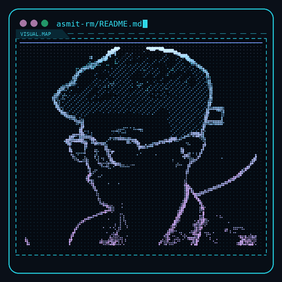

  

  

  

  
  
  
  
  

  

---

<h2 align="center">🔴 About Me</h2>

  Hey! I'm <b>Asmit Kumar Bera</b>, a first-year <b>B.Tech AI &amp; Robotics</b> student at <b>Neotia University</b>, India. 
  Online, almost everyone knows me as <b>Proxy</b>. 
  I build <b>Telegram bots</b>, run <b>hosting services</b>, create <b>IoT projects</b> with Arduino, ESP32 and Raspberry Pi, make <b>APIs</b> and develop <b>OSINT tools</b>.

  
  
  

<table width="100%" border="0" align="center">
  <tr>
    <td width="50%" align="center" style="padding: 14px;">
      <h4>🤖 Telegram Bots</h4>
      
<b>Bot Development</b> Custom bots &amp; automation

    </td>
    <td width="50%" align="center" style="padding: 14px;">
      <h4>🌐 Hosting Services</h4>
      
<b>Hosting</b> Running &amp; managing services

    </td>
  </tr>
  <tr>
    <td width="50%" align="center" style="padding: 14px;">
      <h4>🔌 IoT &amp; Embedded</h4>
      
<b>Arduino · ESP32 · Raspberry Pi</b> Hardware projects

    </td>
    <td width="50%" align="center" style="padding: 14px;">
      <h4>🔍 APIs &amp; OSINT</h4>
      
<b>API Making &amp; OSINT Tools</b> Data &amp; automation tooling

    </td>
  </tr>
</table>

---

<h2 align="center">🛠️ Tech Stack &amp; Skills</h2>

<b>Hardware &amp; Platforms</b>

  

  
  
  
  

---

<h2 align="center">📊 GitHub Analytics &amp; Activity</h2>

  
  

  

---

<h2 align="center">📬 Let's Connect &amp; Collaborate</h2>

  <i>Got a bot, an IoT idea or an API to build? Reach out. I'm always up for new projects.</i>

<table border="0" align="center">
  <tr>
    <td align="center" width="200" style="padding: 16px;">
       
      <b>Professional Network</b>
    </td>
    <td align="center" width="200" style="padding: 16px;">
       
      <b>@evulieon</b>
    </td>
    <td align="center" width="200" style="padding: 16px;">
       
      <b>@REVULET</b>
    </td>
    <td align="center" width="200" style="padding: 16px;">
       
      <b>Direct Collaboration</b>
    </td>
  </tr>
</table>

  

